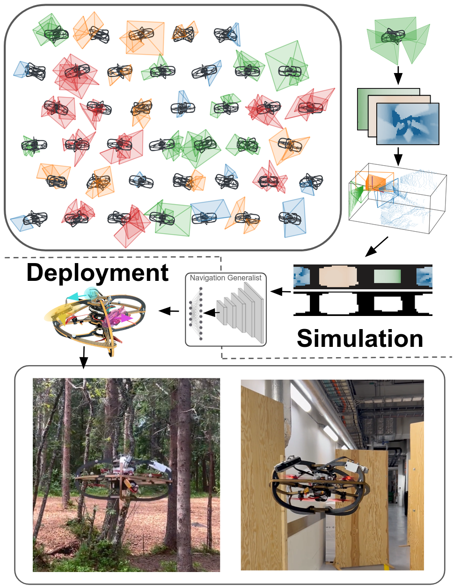
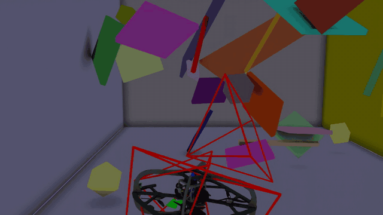

# General Navigation Policy

<div align="center">
  <a href="https://ntnu-arl.github.io/GenNavPolicy/"></a>
  <a href="https://arxiv.org/abs/2610.08306"></a>
  <a href="https://www.youtube.com/watch?v=LLvyCoh5PL0"></a>
  <a href="LICENSE"></a>
</div>

## Overview

<table>
  <tr>
    <td width="52%" valign="top">

One policy for arbitrary depth-camera layouts on a multirotor: individual depth observations are canonicalized into a shared spherical range image and validity mask, trained with reinforcement learning, and flown zero-shot on unseen camera setups. This repository provides:

- **Training**: RL training for a spherical-range CNN-GRU navigation policy (`scripts/train_skrl.py`)
- **Play / evaluation**: Roll out and score checkpoints (`scripts/play_skrl.py`, `scripts/evaluate_skrl.py`)
- **Docker workflow**: Containerized sim stack via `docker/run.sh` (Isaac Sim **6.1** + Isaac Lab **`v3.0.0-EA`**)
- **Pretrained policy**: Checkpoint and example video under `pretrained/`

    </td>
    <td width="48%" align="center" valign="top">
      
    </td>
  </tr>
</table>

## Table of contents

- [Method](#method)
- [Project Structure](#project-structure)
- [Installation](#installation)
- [Usage](#usage)
  - [Pretrained assets](#pretrained-assets)
  - [Train](#train)
  - [Play / evaluate](#play--evaluate)
- [Citation](#citation) · [Acknowledgements](#acknowledgements) · [Contact](#contact) · [License](#license)

## Method

One policy for arbitrary depth-camera layouts: depth from any number of cameras is unprojected into the robot body frame and binned into a shared egocentric **spherical range image** plus a binary **validity mask** (observed bins vs blind spots). A lightweight CNN with circular azimuth padding encodes the range image and mask, fuses them with proprioceptive state, and maps to actions through a GRU actor–critic trained with reinforcement learning in Isaac Lab. Training uses aggressive camera randomization and a performance-based obstacle curriculum, so the same policy transfers zero-shot across sensor setups—including layouts and dropouts not seen in training.

See the [project page](https://ntnu-arl.github.io/GenNavPolicy/) for figures, quantitative results, and real-world flights.

## Project Structure

```text
.
├── docker/
│   ├── run.sh                 # start / enter / viz / stop / build wrapper
│   ├── compose.gnp.yaml
│   └── Dockerfile.gnp
├── scripts/
│   ├── train_skrl.py          # RL training
│   ├── play_skrl.py           # interactive / headless rollout
│   └── evaluate_skrl.py       # crash / success metrics
├── general_navigation_policy/
│   ├── tasks/                 # Gym envs, MDP terms, metrics
│   │   └── arbitrary_sensor_setup/
│   └── learning/skrl/         # models, custom PPO-RNN, trainers
├── pretrained/
│   ├── arbitrary_sensor_setup_pretrained.pt
│   ├── agent.yaml
│   ├── example_run_30s.mp4
│   └── example_run_preview.gif
├── overview_figure.png          # Overview figure
├── setup.py
└── LICENSE
```

Typical host layout after setup:

```text
gnp_release/
├── IsaacLab/                  # checkout v3.0.0-EA
└── general-navigation-policy/ # this repo
```

## Installation

**Requirements:**

- Linux + NVIDIA GPU
- [Docker](https://docs.docker.com/engine/install/) ≥ 26 and Compose ≥ 2.25
- [NVIDIA Container Toolkit](https://docs.nvidia.com/datacenter/cloud-native/container-toolkit/latest/install-guide.html)
- NGC access (`docker login nvcr.io` for `nvcr.io/nvidia/isaac-sim:6.1.0`)

**Setup:**

```bash
mkdir -p gnp_release && cd gnp_release
git clone https://github.com/isaac-sim/IsaacLab.git
cd IsaacLab && git checkout v3.0.0-EA && cd ..
git clone https://github.com/ntnu-arl/general-navigation-policy.git
cd general-navigation-policy

./docker/run.sh start    # builds Lab base + GNP image (first run is slow)
./docker/run.sh enter
```

GNP and skrl are installed in the image. The repo is bind-mounted at `/workspace/general_navigation_policy`, so host edits apply immediately.

If you change `setup.py` / package dependencies, rebuild: `./docker/run.sh build`.

## Usage

### Pretrained assets

Shipped under `pretrained/`:

| File | Description |
|------|-------------|
| `arbitrary_sensor_setup_pretrained.pt` | Spherical-range CNN-GRU policy (Lab 3 / skrl 2) |
| `agent.yaml` | Matching skrl agent config |
| `example_run_30s.mp4` | Example follow-cam rollout with camera frustum overlays |
| `example_run_preview.gif` | GIF preview of second episode (~14–28 s) for README embed |

Use the local checkpoint path below (this is **not** Isaac Lab's Nucleus `--use_pretrained_checkpoint`).

### Train

Inside the long-lived train container (`./docker/run.sh enter`):

```bash
cd /workspace/general_navigation_policy

HEADLESS=1 isaaclab -p scripts/train_skrl.py \
  --task Isaac-Arbitrary-Sensor-Setup-ARL-Robot-1-v0 --agent spherical_range_cnn_gru \
  --device cuda:0
```

Isaac Lab 3.0 removed `--headless`; use `HEADLESS=1`. Do **not** set `CUDA_VISIBLE_DEVICES` with Kit — use `--device cuda:N` instead.

<div align="center">

| Task | Description |
|------|-------------|
| `Isaac-Arbitrary-Sensor-Setup-ARL-Robot-1-v0` | Training env (arbitrary multi-camera setup) |

</div>

`exit` the shell, then on the host: `./docker/run.sh stop`.

### Play / evaluate

Prefer a **fresh GPU sidecar** so play/eval does not share the long-lived train container's device allowlist (and does not restart training):

```bash
# host
./docker/run.sh viz --gpus device=2
```

The mapped GPU appears as `cuda:0` inside the sidecar. Then:

```bash
cd /workspace/general_navigation_policy

HEADLESS=1 isaaclab -p scripts/play_skrl.py \
  --task Isaac-Arbitrary-Sensor-Setup-ARL-Robot-1-Play-v0 \
  --model spherical_range_cnn_gru \
  --checkpoint pretrained/arbitrary_sensor_setup_pretrained.pt \
  --device cuda:0

HEADLESS=1 isaaclab -p scripts/evaluate_skrl.py \
  --task Isaac-Arbitrary-Sensor-Setup-ARL-Robot-1-Play-v0 \
  --model spherical_range_cnn_gru \
  --checkpoint pretrained/arbitrary_sensor_setup_pretrained.pt \
  --device cuda:0
```

<div align="center">

| Task | Description |
|------|-------------|
| `Isaac-Arbitrary-Sensor-Setup-ARL-Robot-1-Play-v0` | Play / eval variant |

</div>

For a Kit window on the train container instead, recreate with `GNP_ENABLE_X11=1 ./docker/run.sh start` (stops training). If `nvidia-smi` / CUDA fails inside a long-lived container but host GPUs are fine: `./docker/run.sh stop && ./docker/run.sh start`.

Example follow-cam rollout with camera frustum overlays ([full MP4](pretrained/example_run_30s.mp4)):

<div align="center">
  <a href="pretrained/example_run_30s.mp4"></a>
</div>

## Citation

If you use this code or the pretrained policy, please cite:

```bibtex
@article{rehberg2026gennav,
  title={Sensor-Layout-Agnostic Navigation via Geometric Observation Canonicalization},
  author={Rehberg, Welf and Alexis, Kostas},
  journal={arXiv preprint arXiv:2610.08306},
  year={2026}
}
```

## Acknowledgements

This work was supported by the Horizon Europe Grant Agreement No. 101119774, the Research Council of Norway under Award NO-357451, and the NVIDIA Academic Grant Program using NVIDIA RTX PRO 6000 Blackwell Max-Q and A100 GPU-Hours on Saturn Cloud.

## Contact

- Welf Rehberg — [welf.rehberg@ntnu.no](mailto:welf.rehberg@ntnu.no)
- Kostas Alexis — [konstantinos.alexis@ntnu.no](mailto:konstantinos.alexis@ntnu.no)

## License

BSD 3-Clause. See [LICENSE](LICENSE).
